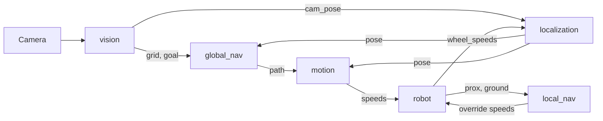

# Thymio autonomous parking

MICRO-452 project. A camera above a parking lot finds the cars, the Thymio and a red target. The Thymio plans a path to the target, drives it, and avoids obstacles added on the way.

**Status: working spec, to validate at four.** The skeleton exists: every function is there and gives back fake data. The real blocks are still to write. Everything marked *to confirm* is a proposal.

How we work: each of us owns one file and writes a few functions in it. The names of these functions, what they receive and what they give back are fixed below. Until someone's block is ready, the others use a fake version of it (a stub). When the real block arrives, nobody else changes their code.

## What the course asks

- **Deadline: Sunday 6 December 2026, 19:00.** Presentations from week 12 (2 December).
- Five graded components: vision, global navigation, motion control, local navigation, Bayesian filtering.
- Cars on the map are avoided by the planned path, without using the sensors.
- Start position and target can be anywhere and are changed during the demo.
- An obstacle can be added at any time; the Thymio avoids it with its sensors.
- During the demo the TAs may **hide the camera** or **move the Thymio by hand**.
- Live visualisation of the map, the path and the pose before/after filtering is graded.
- The report is a Jupyter notebook that runs each block on its own and says who did what.

## The parking lot

- Camera fixed above, looking down. Two or three A0 sheets.
- Grid of **20 cm × 20 cm cells**, drawn with thin blue pen lines.
- Wide **black line** around the lot: the Thymio must never cross it.
- **Cars** are black 3D boxes: black so the camera sees them, 3D so the Thymio's sensors see them. Make them smaller than a cell (about 15 cm) to leave room to turn.
- **Target** is a piece of red paper.
- **Thymio** carries a coloured rectangle with a small dot towards the front, giving position and heading.
- **Added obstacle** must not be black, so that the camera does not take it for a car and only the sensors detect it.
- Bottom row is always free. Any free cell can be driven through, aisle or empty bay.

## Files

What you open most is at the root. All the code is in one folder, `src/`, with one file per block. No classes.

```
README.md                this spec
report.ipynb             the report: one section per block, then the full run
main.py                  runs the full demo
requirements.txt         numpy, opencv-python, matplotlib, tdmclient
src/
    common.py            shared constants, two helper functions, the shared example
    stubs.py             fake version of every block
    vision.py            Joshua
    localization.py      Joshua     (the filter, last)
    global_nav.py        Malvyn
    visualization.py     Malvyn     (to confirm)
    motion.py            Antoine
    robot.py             Antoine    (link with the Thymio)
    local_nav.py         Laurent
data/                    recorded images and logs, used by the notebook
```

`main.py` is Antoine's *(to confirm)*. `common.py`, `stubs.py` and this README belong to all four and only change when we agree.

The notebook holds the explanations, the measurements and the plots. The code stays in `src/`; the notebook and `main.py` import it the same way:

```python
from src import common, vision, global_nav
```

Always start the notebook and `main.py` from the root of the repository, so that this import works.

To get started, install the libraries, then run the demo on fake data:

```bash
pip install -r requirements.txt
```

```bash
python main.py
```

It prints three lines with the example pose, goal and path. Then open your own file in `src/`: each function says what it receives, what it must give back, and has a `TODO` with your name.

## Conventions

- **Units:** metres, radians, seconds. Wheel speeds are in Thymio units (about −500 to 500).
- **Frame:** origin at the bottom-left inside corner of the black border. x to the right, y up.
- **Heading:** `theta = 0` points along +x, positive counter-clockwise, between −π and π.
- **Robot position:** the middle of the wheel axis, not the centre of the marker.
- **Not visible:** `None`. Never an old value, never `(0, 0)`.

Positions are real distances in metres, not a 0-to-1 scale and not cell numbers. `0.10` means 10 cm. On the example lot of 6 × 4 cells, x goes from 0 to 1.20 and y from 0 to 0.80:

```
y (m)
0.80 ┌─────┬─────┬─────┬─────┬─────┬─────┐
     │     │     │     │     │ car │     │  row 0
0.60 ├─────┼─────┼─────┼─────┼─────┼─────┤
     │     │     │ car │     │GOAL │     │  row 1
0.40 ├─────┼─────┼─────┼─────┼─────┼─────┤
     │ car │     │ car │     │ car │     │  row 2
0.20 ├─────┼─────┼─────┼─────┼─────┼─────┤
     │ROBOT│     │     │     │     │     │  row 3
0.00 └─────┴─────┴─────┴─────┴─────┴─────┘
     0    0.20  0.40  0.60  0.80  1.00  1.20   x (m)
```

- The robot is at `(0.10, 0.10)`: the centre of the bottom-left cell, 10 cm from the left edge and 10 cm from the bottom.
- The goal is at `(0.90, 0.50)`: the centre of the cell in row 1, column 4.
- A pose has a third number, the heading: `0.0` faces right, about `1.57` (π/2) faces the top of the lot.

The grid is in cells because cars fill cells. Positions are in metres because the robot is almost never exactly at the centre of a cell, and the controller and the filter need to know by how much.

Shared constants in `src/common.py`:

| Constant | Meaning | Value |
|---|---|---|
| `CELL` | side of a cell, in m | `0.20` |
| `ROWS`, `COLS` | size of the grid | set when the lot is built |
| `THYMIO_TO_MS` | m/s per Thymio speed unit | measured by Antoine |
| `WHEEL_BASE` | distance between the wheels, in m | measured by Antoine |
| `WAYPOINT_TOL` | distance at which a waypoint counts as reached, in m | chosen by Antoine |

Nobody converts between cells and metres by hand. `common.py` has the only two functions that do it:

```python
def cell_to_xy(row, col):    # centre of the cell, in metres
    return (col + 0.5) * CELL, (ROWS - row - 0.5) * CELL

def xy_to_cell(x, y):        # cell containing the point
    return ROWS - 1 - int(y // CELL), int(x // CELL)
```

## Data passed between blocks

Only plain Python values: tuples, lists and NumPy arrays.

| Name | Format | Example |
|---|---|---|
| `grid` | NumPy array, `ROWS × COLS`. `0` = free, `1` = car. `grid[row, col]`, row 0 at the top | see below |
| `cam_pose` | `(x, y, theta)`: the robot as seen by the camera | `(0.10, 0.10, 0.0)` |
| `pose` | `(x, y, theta)`: best estimate of where the robot is | `(0.10, 0.10, 0.0)` |
| `goal` | `(x, y)`: centre of the red paper | `(0.90, 0.50)` |
| `path` | list of `(x, y)` waypoints, in driving order | see below |
| `prox` | list of 7 numbers: horizontal proximity sensors | `[0, 0, 0, 0, 0, 0, 0]` |
| `ground` | list of 2 numbers: ground sensors, left then right | `[900, 900]` |
| `wheel_speeds` | `(left, right)`: speeds measured by the Thymio | `(100, 100)` |
| `cov` | 3 × 3 NumPy array: uncertainty of `pose` | `None` until the filter exists |

Rules that go with them:

- **`grid`**: a cell is `1` as soon as a box covers a real part of it; a box across two cells marks both. The robot and the red paper never produce a `1`. `None` when the camera is hidden.
- **`cam_pose`**: `None` when the marker is not found.
- **`goal`**: `None` when the red paper is not found, for example when the robot is on it.
- **`pose`**: `None` when the position is unknown; the robot then stops.
- **`path`**: does not contain the start. Waypoints are cell centres, except the last one, which is the exact goal. An empty list `[]` means no path.
- **`prox`**: Thymio order: front left, front centre-left, front centre, front centre-right, front right, back left, back right. `0` = nothing, larger = closer.
- **`ground`**: high on white paper, low on the black border.

**Change from the first sketch:** the grid only holds `0` and `1`. The robot is a pose `(x, y, theta)` and the target a point `(x, y)`, not a `2` and a `3` in the matrix. A cell with a North/South/East/West flag is too coarse to steer the robot or to filter its position. The visualisation still draws the robot and the target on the grid.

## Functions of each block

Each file exposes exactly these functions. What happens inside is the owner's business.

| File | Function | Gives back |
|---|---|---|
| `vision.py` | `read_frame()` | the camera image, or `None` |
| `vision.py` | `detect(frame)` | `grid, cam_pose, goal` |
| `localization.py` | `update(cam_pose, wheel_speeds, dt)` | `pose, cov` |
| `global_nav.py` | `plan(grid, pose, goal)` | `path` |
| `motion.py` | `go_to(waypoint, pose)` | `left, right, reached` |
| `robot.py` | `connect()` | nothing |
| `robot.py` | `read()` | `prox, ground, wheel_speeds` |
| `robot.py` | `set_speed(left, right)` | nothing |
| `local_nav.py` | `avoid(prox, ground)` | `None`, or `(left, right)` |
| `visualization.py` | `show(grid, goal, path, cam_pose, pose)` | nothing; refreshes the display |

- **`detect`**: if `frame` is `None`, it gives back `None, None, None`.
- **`update`**: `dt` is the time since the last call, in seconds. First version: gives back `cam_pose, None`. Final version: a Kalman filter that predicts with `wheel_speeds` and corrects with `cam_pose` when it is not `None`.
- **`plan`**: gives back `[]` if the robot or the goal is outside the lot or on a car, or if no path exists.
- **`go_to`**: `left` and `right` are wheel speeds; `reached` is `True` when the robot is within `WAYPOINT_TOL` of the waypoint.
- **`avoid`**: `None` means nothing is in the way. Wheel speeds mean local navigation takes over. On the black border it gives back `(0, 0)`.

## How the blocks run together



One turn of the main loop, about ten times per second:

```python
grid, cam_pose, goal       = vision.detect(vision.read_frame())
prox, ground, wheel_speeds = robot.read()
pose, cov                  = localization.update(cam_pose, wheel_speeds, dt)
override                   = local_nav.avoid(prox, ground)
# the state decides what goes to robot.set_speed(...)
visualization.show(grid, goal, path, cam_pose, pose)
```

The main loop remembers the last `grid` and the last `goal` that were not `None`. It never does that for the position: **every block uses `pose`, never `cam_pose`**. That is the shared "current location", and it is why the filter can arrive last without anyone else changing code.

| State | What happens | Next |
|---|---|---|
| `PLAN` | Robot stopped; `global_nav.plan` | path found → `FOLLOW` |
| `FOLLOW` | `motion.go_to` the current waypoint | `override` not `None` → `AVOID` · grid or goal changed, or robot far from the path → `PLAN` · last waypoint reached → `DONE` |
| `AVOID` | `override` goes to the wheels | `override` is `None` again → `PLAN` from the current pose |
| `DONE` | Robot stopped on the target | goal moved → `PLAN` |

In every state, `pose` is `None` → stop.

## Working alone with stubs

`stubs.py` has a fake version of every function above, with the same name and the same outputs. They give back the shared example from `common.py`:

```python
EXAMPLE_GRID = np.array([
    [0, 0, 0, 0, 1, 0],
    [0, 0, 1, 0, 0, 0],
    [1, 0, 1, 0, 1, 0],
    [0, 0, 0, 0, 0, 0],
])
EXAMPLE_POSE = (0.10, 0.10, 0.0)          # bottom-left cell, facing +x
EXAMPLE_GOAL = (0.90, 0.50)               # row 1, column 4
EXAMPLE_PATH = [(0.30, 0.10), (0.50, 0.10), (0.70, 0.10),
                (0.70, 0.30), (0.70, 0.50), (0.90, 0.50)]
```

1. On day one, every block file is a copy of its stub, so `main.py` already runs from start to end on fake data.
2. Each of us replaces the inside of our own functions. Names, inputs and outputs do not move.
3. When a real block is pushed, everybody else's code keeps working unchanged.
4. To test without the camera or the robot later, swap one line: `from src import stubs as vision`.

A block is ready when it gives the right values on the shared example.

## Git rules

- Each block has its branch: `vision`, `global-navigation`, `motion-control`, `local-navigation`, `kalman-filter`. Work on the branch of your block.
- Before you start, and every few days, bring `main` into your branch: `git pull --no-rebase origin main`.
- Only edit the files you own. Two people never touch the same file, so there are no conflicts.
- Merge your branch into `main` often, even when the block is not finished, as soon as `python main.py` still runs.
- Only one person edits `report.ipynb` at a time; say so in the group chat first. Notebooks do not merge.
- A change to `common.py`, `stubs.py` or to a function in the table above is agreed at four first, and this README is updated in the same commit.

## Tasks

**Vision — Joshua**
- [ ] Turn the camera image into a top-down view of the lot in metres (four corners).
- [ ] Find the black boxes and fill `grid`.
- [ ] Find the red paper → `goal`.
- [ ] Find the robot marker → `cam_pose`; the dot gives the heading.
- [ ] Give back `None` for whatever is hidden.

**Global navigation — Malvyn**
- [ ] Shortest path on `grid` (A*, four neighbours) from the cell of `pose` to the cell of `goal`.
- [ ] Give back a `path` that follows the rules above, `[]` in every failure case.
- [ ] Live visualisation *(to confirm)*.

**Motion control — Antoine**
- [ ] `robot.py`: connection, sensors, wheel speeds.
- [ ] Measure `THYMIO_TO_MS` and `WHEEL_BASE`.
- [ ] `go_to`: turn towards the waypoint, drive to it while correcting the heading.
- [ ] `main.py` and its four states *(to confirm)*.

**Local navigation — Laurent**
- [ ] Measure at what distance the sensors see our boxes and test objects.
- [ ] `avoid` steers around an obstacle and gives back `None` once it is passed.
- [ ] Must not trigger on parked cars beside the aisle while driving normally.
- [ ] Detect the black border with the ground sensors.

**Filtering — Joshua, once the first full run works**
- [ ] Kalman filter on `(x, y, theta)` inside `localization.update`.
- [ ] Camera hidden (`cam_pose` is `None`): keep predicting, the robot keeps driving.
- [ ] Fill `cov`; show camera pose and filtered pose on the same plot.

## Milestones

| Date | Done when |
|---|---|
| Sun 15 Nov | Spec agreed, lot built, files created with the stubs, `main.py` runs on fake data |
| Sun 22 Nov | Each block works alone on the real camera or the real Thymio |
| Wed 25 Nov | First full run: camera → path → Thymio reaches the target |
| Sun 29 Nov | Added obstacle avoided; Kalman filter in; camera hidden and kidnapping tested |
| Wed 2 Dec | Live visualisation and backup video ready |
| Sun 6 Dec, 19:00 | Notebook submitted |

## To check or decide

- **Robot marker:** a printed ArUco marker read with OpenCV would give position and heading in one call, instead of the coloured rectangle and dot. Less code, and less sensitive to lighting. Joshua to decide.
- **Blue pen lines:** can the ground sensors see them? Probably not: they measure infrared reflection, and a thin line is easy to miss. If they can, counting line crossings could help when the camera is hidden; until then it is not part of the plan.
- **Turning room:** is a 20 cm cell enough to turn in place next to our boxes?
- **Blocked aisle:** an obstacle in an aisle with cars on both sides cannot be driven around; the robot stops and replans.

## Not in the first version

Parking with a given final orientation, reverse parking, line-crossing correction, routes limited to aisles.
